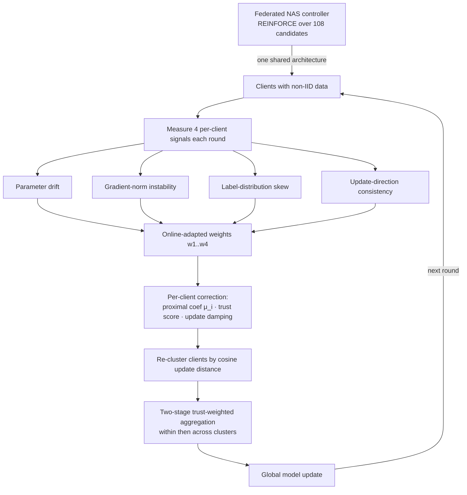

# Adaptive Federated Learning with NAS and Dynamic Clustering

**Privacy-Preserving Federated Neural Architecture Search with Per-Client Heterogeneity Adaptation**

A federated learning (FL) framework that measures **four per-client heterogeneity signals** every round and turns them into **client-specific corrections**, selects a shared model with **federated NAS**, and aggregates updates through **trust-weighted dynamic clustering** that provably reduces to simple averaging under uniform trust.

Under severe non-IID data (Dirichlet α = 0.1), it outperforms FedAdam by **1.58–5.51 pp** on MNIST, CIFAR-10, and CIFAR-100.

> Final Year Design Project (FYDP), Dept. of CSE, United International University (UIU).

---

## Table of Contents
- [Motivation](#motivation)
- [Key Idea](#key-idea)
- [Method Overview](#method-overview)
- [Results](#results)
- [Repository Structure](#repository-structure)
- [Getting Started](#getting-started)
- [Reproducing the Experiments](#reproducing-the-experiments)
- [Privacy Layer (Scaffold)](#privacy-layer-scaffold)
- [Limitations](#limitations)
- [Citation](#citation)
- [Authors](#authors)
- [License](#license)

---

## Motivation

Federated learning trains one shared model across many clients without moving their data to a server. When clients hold very different (non-IID) data — one sees mostly cats, another mostly ships — their local updates pull the shared model in conflicting directions and accuracy falls sharply.

Standard remedies each fix **one** aspect and apply it **identically to every client**:
- **FedProx** — a single fixed proximal term
- **FedAdam** — a better server-side optimizer
- **Clustered FL** — client grouping

None turns a client's *own* behaviour into a client-specific correction, even though clients differ simultaneously in **parameter drift, gradient stability, label skew, and update consistency**.

## Key Idea

> Measure each client's behaviour during training, and give every client its **own** correction.

## Method Overview



**Components**
1. **Four-signal adaptive client optimization** — four measured heterogeneity signals become a dynamic proximal coefficient, a trust weight, and a damping factor, per client, per round.
2. **Federated NAS** — a REINFORCE controller selects **one shared architecture** from 108 candidates using noised, securely aggregated validation rewards. The same architecture is used by **every baseline** for a fair comparison.
3. **Trust-weighted hierarchical aggregation** — clients are re-clustered each round by cosine update distance; aggregation runs within then across clusters and **provably reduces to the arithmetic mean under uniform positive trust**.
4. **Privacy layer (scaffold)** — gradient clipping, Gaussian noise, simulated secure aggregation, and a Paillier proof of concept, analysed with (ε, δ)-DP accounting.

> **Fair-comparison note:** the full infrastructure (privacy, dynamic clustering, hierarchical aggregation, client dropout) is applied to **all** methods — FedAvg, FedProx, FedAdam, and Adaptive. The **only** difference between them is the core optimizer, so any gain comes purely from the gap-aware client-side adaptation.

## Results

Multi-seed results (mean ± 95% CI over **7 seeds**, leakage-corrected protocol, 40 clients, Dirichlet α = 0.1). **Δ** is the gain over the strongest baseline (FedAdam), in percentage points.

| Dataset   | FedAvg | FedProx | FedAdam | **Proposed** | Δ (pp) |
|-----------|:------:|:-------:|:-------:|:------------:|:------:|
| MNIST     | 0.9582 | 0.9583  | 0.9750  | **0.9908**   | **+1.58** |
| CIFAR-10  | 0.4055 | 0.4055  | 0.4650  | **0.5023**   | **+3.73** |
| CIFAR-100 | 0.1293 | 0.1293  | 0.1762  | **0.2314**   | **+5.51** |

**Highlights**
- **Wins on every dataset**, with the largest gain on the hardest task (CIFAR-100).
- **Statistically significant:** paired *t*-test p ≤ 5×10⁻⁴ across all nine proposed-vs-baseline comparisons (down to ≈3×10⁻⁸ on CIFAR-100); Wilcoxon p = 0.016 — the minimum attainable at 7 seeds (proposed wins all 7).
- **Insensitive to cluster count:** varying K from 1 to 8 moves accuracy by under 1 pp — the gain comes from client-side adaptation, not clustering.
- **Negligible communication overhead:** only +16 bytes per client per round over the baselines; clustering and trust are computed server-side.

## Repository Structure

```
.
├── adaptive_fl_unified_k6.ipynb   # One-run-all pipeline (NAS → train all methods → results)
├── figures/                       # Convergence curves, ablation plots
├── results/                       # Saved accuracy logs / tables
├── README.md
└── requirements.txt
```

> The main notebook runs all four phases for all three datasets end to end: for each dataset it (1) searches an architecture with the NAS controller, then (2) trains that architecture with FedAvg / FedProx / FedAdam and the full Adaptive method.

## Getting Started

### Requirements
- Python 3.10+
- PyTorch, NumPy, scikit-learn, Matplotlib
- A GPU runtime is strongly recommended (CIFAR-100 is heavy)

```bash
git clone https://github.com/<your-username>/<repo-name>.git
cd <repo-name>
pip install -r requirements.txt
```

## Reproducing the Experiments

Open the notebook and run all cells:

```bash
jupyter notebook adaptive_fl_unified_k6.ipynb
```

Or run it on Google Colab with a GPU runtime (keep the tab awake for CIFAR-100).

Key configuration (set near the top of the notebook):
- `DATASETS` — `["mnist", "cifar10", "cifar100"]`
- `ALPHA` — Dirichlet concentration (default `0.1`)
- `N_CLIENTS` — number of clients (default `40`)
- `ROUNDS` — communication rounds per dataset
- `K` — number of clusters
- `dp_sigma` — DP noise multiplier (default `0.01`)

## Privacy Layer (Scaffold)

The privacy layer provides gradient clipping, Gaussian noise, simulated pairwise masking, and a Paillier summation proof of concept, with formal (ε, δ)-DP accounting (Rényi-DP, δ = 10⁻⁵).

**Important:** at the operating noise level (σ = 0.01) the accounted ε is very large, and reducing it to single digits collapses accuracy. The privacy layer is a **research scaffold, not a deployable guarantee**. Closing this gap (subsampling amplification, tighter accounting, end-to-end secure aggregation) is future work.

## Limitations

- No practical (ε, δ)-DP guarantee is yet achieved at useful accuracy.
- Pairwise masking is simulated; Paillier encryption is verified only on a 256-coordinate slice and excluded from training, so end-to-end secure aggregation is not established.
- The trust score measures only a client's self-consistency across rounds; it does not compare clients against each other and would not detect a consistently malicious client (cross-client outlier detection is future work).
- Experiments use three image datasets, small CNNs, and simulated clients; larger-scale and real-device deployment remain to be evaluated.


## License

Released under the MIT License — see [`LICENSE`](LICENSE). *(Add a LICENSE file, or change this line if you prefer another license.)*
